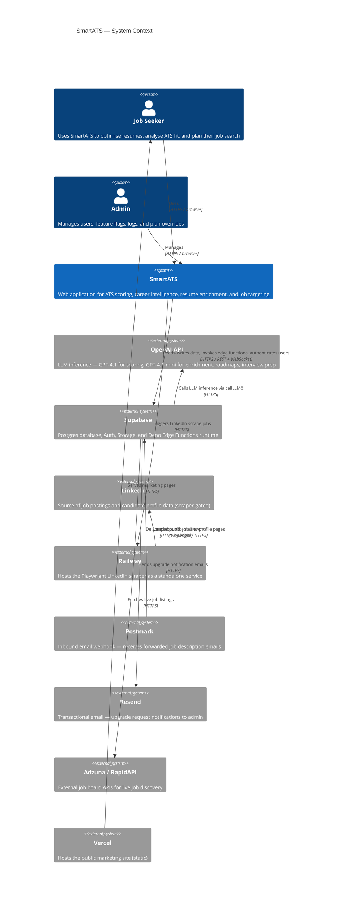
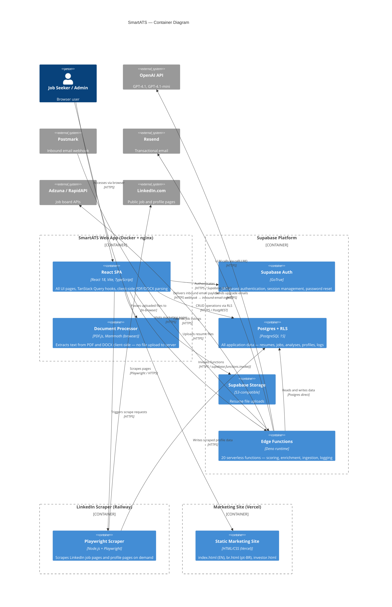
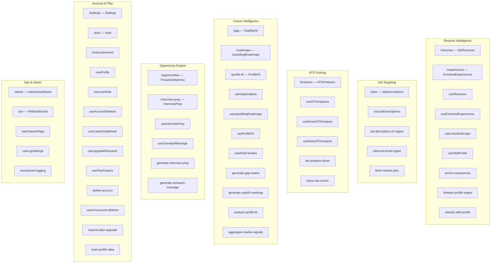
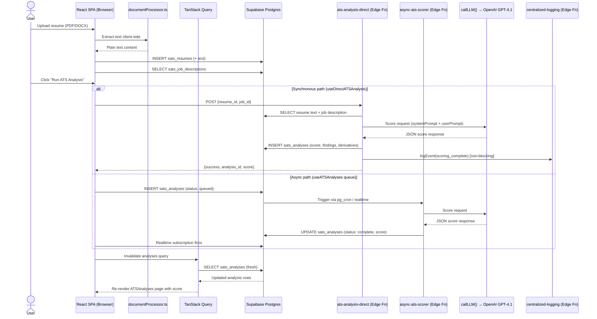
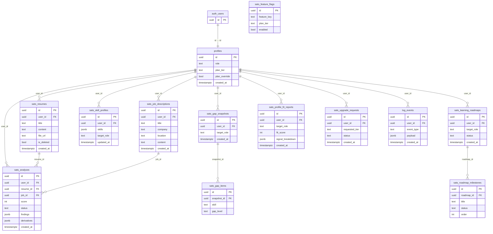

# SmartATS — Architecture Diagrams

Generated: 2026-06-05  
Format: Mermaid (compatible with Notion, mermaid.live, GitHub, and any Mermaid renderer)

---

## Diagram 1 — System Context (C4 Level 1)

Who it's for: stakeholders, new engineers, investors.  
Shows the product as a black box and all external systems it touches.

---

## Diagram 2 — Container Diagram (C4 Level 2)

Who it's for: engineers, DevOps.  
Shows every deployed runtime unit and how data flows between them.

---

## Diagram 3 — Domain Module Map

Who it's for: product and engineering teams.  
Shows the 7 functional domains, each grouping its pages, TanStack Query hooks, and edge functions.

---

## Diagram 4 — Data Flow: Core ATS Scoring Pipeline

Who it's for: engineers debugging or extending the scoring pipeline.  
Traces a score from file upload to persisted result in full detail.

---

## Diagram 5 — Database Entity Diagram (Core Domains)

Who it's for: engineers adding features or writing migrations.  
Groups key tables by domain with foreign key relationships. Legacy tables shown without `sats_` prefix.

